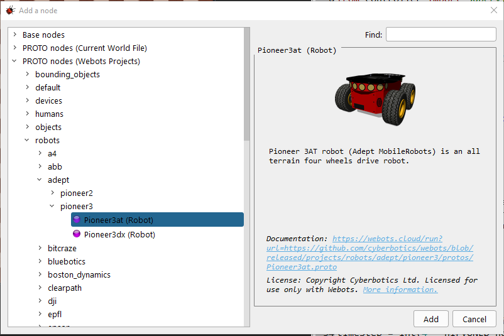
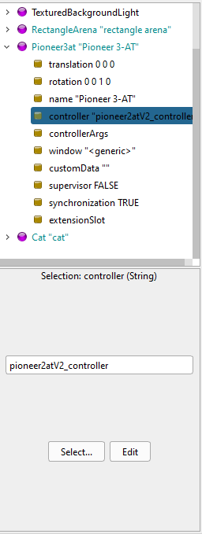
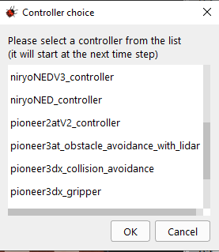
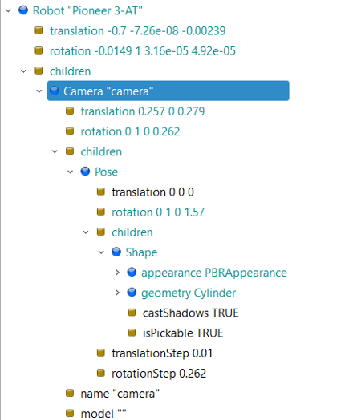

# Opdracht 1: Mobile platformen

In deze opdracht leer je hoe je mobiele platformen kunt besturen en simuleren met Webots. Je gaat aan de slag met het programmeren van een mobiel robotplatform en het uitvoeren van verschillende bewegingstaken.

:::{note}
Voordat je begint met deze opdracht, is het belangrijk dat je Webots hebt geïnstalleerd en dat je enige kennis van Python hebt, zie [installatie](./install.md)
:::

## Doelstellingen

In deze workshop leer je het volgende:

Bouwen van een visualisatie van een robotcel bestaande uit:
Rijdend platform
Obstakels

Het koppelen van een controller aan de robot

Het uitbreiden van de functionaliteit van de controller door het aanpassen van het controller python programma

Het toevoegen van sensors (o.a. camera) aan het rijdend platform en deze sensor te gebruiken in de controller

Er wordt van je verwacht dat je enige kennis van de programmeertaal Python hebt.
Heb je dat nog niet volg dan de volgende course (buiten de lestijd)
    [Python Course](https://www.python.org/about/gettingstarted/)

## Opdracht 1.1: Kennismaken met Webots

Volg het eerste deel van de online tutorial op de Webots site:
- [Tutorial 1: Your First Simulation in Webots](https://cyberbotics.com/doc/guide/tutorial-1-your-first-simulation-in-webots)

- Als je bij het onderdeel “Create a New Controller” aankomt zorg ervoor dat je Python selecteert voor de code.


- Je kunt de code door copy en paste in je eigen controller zetten.
- Vergeet niet je controller-bestand op te slaan alvorens je de simulatie start!

## Opdracht 1.2: Besturen van het mobiele platform

In deze opdracht ga je het mobiele platform besturen met behulp van the controller die je in de vorige opdracht hebt aangemaakt. Je leert hoe je de bewegingen van het platform kunt programmeren en simuleren in Webots.

### Opdracht 1.2.1: Arena bouwen
Maak een nieuwe “wereld”:
- Open het `<pad_naar_workshopbestanden>/workspace/worlds/empty_world.wbt` bestand
File→Open World…
Navigeer naar de worlds map en selecteer het juiste bestand


- Sla dit bestand op als `<pad_naar_workshopbestanden>/workspace/worlds/mobile_platform.wbt` bestand
File→Save World As...

Pas de RectangleArena aan:
- (attribute)floorSize: 5 x 5 meter
- Tweak eventuele andere attributten zodat je een gepersonaliseerde arena krijgt waarin het mobiele platform kan rond rijden

Sla het bestand op
- File→Save World

### Opdracht 1.2.2: Toevoegen van de robot aan de arena
Voeg een node in de vorm van een Pioneer3at toe aan de arena
- Zorg ervoor dat je met de muis in de “3D Window” staat. (Click 1 keer met je muis voor de zekerheid)
- Gebruik de + knop om een node toe te voegen



- Selecteer de “Pioneer3at” robot en click op “Add”
:::tip
Je kunt ook de Find functie gebruiken
:::


Als de robot is geplaats, kun je hem verplaatsen naar een door jou gekozen plaats in de arena.
- Click op de robot en verplaats hem met de rode of groene pijl

Sla de wereld op

## Opdracht 1.2.3: Toevoegen van de obstakels aan de arena
Plaats een aantal obstakels in de arena, willekeurig verspreid
- Je kunt de nodes uit “PROTO nodes(Webots Projects)” gebruiken
- Bijvoorbeeld:
    - PROTO nodes(Webots Projects)→Objects→drinks→Can


Zorg er voor dat de objecten ongeveer even hoog zijn als de Pioneer3at robot.
- Gebruik hiervoor het scale-attribute van het geplaatste object
  - Soms zijn er nog andere attributen waarmee je de omvang van het object kunt bepalen


Sla de wereld op

## Opdracht 1.2.4: Simulatie starten
Je kunt de simulatie nu starten, echter je zult ontdekken dat er nog niet gebeurt, toch behandelen we hier even de belangrijkste knoppen


1. Simulatie Start/Stop
   - Start of stop de simulatie
2. Simulatie in kleine stapje(tijdseenheden)
   - Laat de simulatie stap voor stap verlopen
3. Simulatie op maximale snelheid die de computer kan leveren
   - Laat de simulatie zo snel mogelijk verlopen
4. Rewind Simulatie
   - Simulatie gaat weer naar uitgangspositie
   - Gebruik deze functie altijd voordat je iets wijzigt aan de wereld
5. Simulatie tijd
   - Geeft de huidige simulatie tijd weer

:::{note}
Als de simuatie niet werkt kijk dan bij [Veelgestelde vragen](faq.md)
:::

## Opdracht 1.2.5: Controller toevoegen voor Pioneer3at
Als je probeer te simuleren zul je merken dat de robot nog niet beweegt. Er is nog geen controller aan toegevoegd.

Voeg een controller toe
- Navigeer in de “Scene Tree” naar het controller attribute
  - Pioneer3at”Pioneer 3-AT”controller



- Selecteer de “Pioneer2atV2_controller”



- Sla de wereld op

Start een simulatie

## Opdracht 1.2.6: Verkennen van de controller

Open het “Pioneer2atV2_controller.py” bestand in de Code Editor (rechter paneel)

Bestudeer dit Python bestand en zoek de regel
- “# Voeg hier je eigen bewegingen aan toe”

```python
# Voeg hier je eigen bewegingen aan toe
# movement_states definition
# Alle toestanden(states) kunnen meerder functies hebben b.v. Entry, Do, Exit functie. Deze worden in 1 regel als List gedefineerd
# Elke Functie dient ten minste een isReady als result te hebben, welke aangeeft dat de volgende functie/toestand aan de beurt is
movement_states =[['isReady = pioneer.moveForward(4)', 'isReady = timer.start(2)', 'isReady = timer.isReady()'],
                  ['isReady = pioneer.rotateRight(1.5)', 'isReady = timer.start(1.5)', 'isReady = timer.isReady()'],
                  ['isReady = pioneer.moveForward(3)', 'isReady = timer.start(3)', 'isReady = timer.isReady()'],
                  ['isReady = pioneer.moveForward(0)', 'isReady = timer.start(1.5)', 'isReady = timer.isReady()']]
```
- In movement_states is het bewegingspatroon van de Pioneer3at gedefinieerd, deze kun jezelf aanpassen  

:::{note}

Met de Pioneer3at Class kun je de volgende Python functies in je movement_states list opnemen:
```python
pioneer.moveForward(speed)
pioneer.moveBackward(speed)
pioneer.rotateRight(speed)
pioneer.rotateLeft(speed)
```

Elke functie geeft een isReady retour, welke gebruikt word in de toestanden(state) afhandeling dat de volgend toestand aan de beurt is
De def execute_states_list(states) functie over deze taak uit

Let op: pioneer is een afgeleid object van de klasse Pioneer3at

```python
pioneer = Pioneer3at(pioneer_node)
```
:::

:::{note}

Met de Timer Class kun je de volgende Python functies in je movement_states list opnemen:
```python
timer.Start(time)
```
Start de timer voor de gespecificeerde tijd
```python
timer.isReady()
```
Controleert of de timer klaar is en geeft de volgende waardes terug
- False: Timer is nog niet klaar en volgende toestand is nog niet aan de beurt
- True: Timer is klaar, volgende toestand kan worden uitgevoerd

Let op: timer is een afgeleid object van de klasse Timer
```python
timer = Timer(pioneer_node)
```

:::

### Opdracht 1.2.7: Bewegingen uitbreiden
Breid de movement_states list in het “Pioneer2atV2_controller.py” uit met minimaal 5 bewegingen
- Navigeer om de geplaatste obstakels heen

- De volgende aandachtspunten zijn aan de orde:
  - Elke functie die je aanroept heeft een isReady resultaat
  - Let op het gebruik van de volgende tekens
    - ‘ of  ’, “ of  “
    - ( of )
    - [ of ]

Sla het “Pioneer2atV2_controller.py”  regelmatig op

Test je simulatie


### Opdracht 1.3: Toevoeg van virtuele camera

In deze opdracht ga je een virtuele camera toevoegen aan de Pioneer3at robot in de simulatie.

Converteer de Pioneer 3-AT robot naar “Base Nodes”:
- Selecteer de robot in de Scene Tree
- Rechtermuisclick  Convert to Base Node(s)
  - Door deze handeling wordt het mogelijk om “Childeren” aan de robot toe te voegen. Een “Child” kan een sensor, object, etc. zijn die een relatie heeft met zijn “Parent”

Expandeer de Pioneer 3-AT node en selecteer de Childeren-node
- Voeg aan de Childeren-node een camera toe
  - Er wordt een virtuele camera gemaakt welke (nog) geen visuele vorm heeft

- Activeer in de controller de camera door de “use_camera” variable van `False` naar `True` te wijzigen

### Opdracht 1.3.1: Toevoegen van shape aan camera
De camera is niet zichtbaar als object. We voegen een cilinder toe als visual object, welke de camera voorstelt.

Expandeer van de camera de Childeren-node en voeg hieraan een Pose toe.
- Dit is de positie en rostatie van de cilinder(die je later toevoegt) ten opzichte van de camera. Je hoeft hiervan de attributen niet te wijzigen

Expandeer van de Pose de Childeren-node en voeg hieraan een Shape in de vorm van een cilinder(geometry Cylinder) toe
- Wijzig het appearance atrribute in PBRAppearance en selecteer een kleur voor de cilinder
- Zorg ervoor dat de cilinder de juiste afmetingen en plaats op de robot, maak hiervan zelf een inschatting




## Opdracht 1.4: Testen

Test de camera aan de hand van je simulatie. Bestudeer het gedrag en controleer of de camera in zijn geheel mee beweegt met de robot.

De camera heeft nog geen “Object Recognition” (object herkenning). Er verschijnen nog geen kaders om de objecten die door de camera worden gezien.

Wijzig de simulatie dat de objecten wel door de camera worden gezien. Dit dient op twee plaatsen te gebeuren:
In de Scene tree
In het controller programma

Test de werking van de object herkening.
