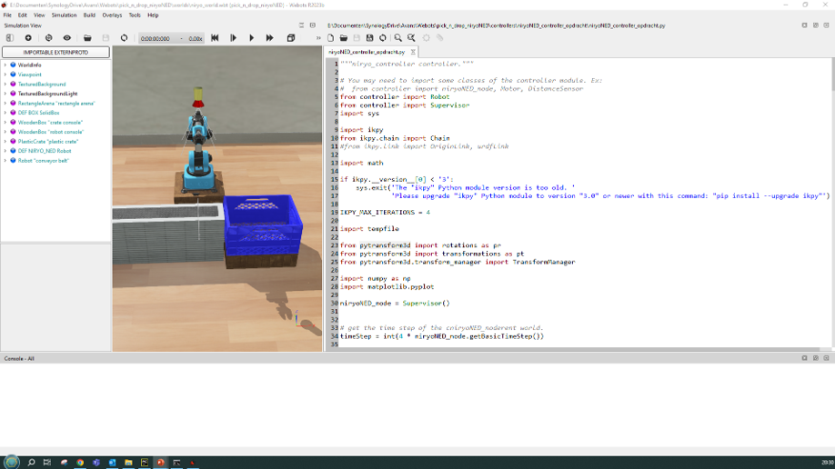
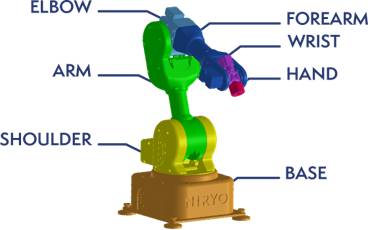

# Opdracht 2: Kinematics met Manipulatoren

In deze workshop zul je doormiddel van een robot simulatie met ervaring opdoen met:
- Transfeur-frames
- Inverse-kinematica

Deze workshop ondersteund de theorie die je geleerd hebt in de lesstof van
Introduction in Robotics Kinematica

## Doelstellingen
- Begrijpen en toepassen van transfeur-frames
- Implementeren van inverse-kinematica voor een robotarm
- Programmeren van een robotcontroller in Python
- Simuleren van een robotarm die objecten oppakt en verplaatst

## Voorbereidingen
Neem de volledige voorbereiding door voordat je begint met de opdracht.

### Starten en openen Webots-project

1. Start het Webots programma

2. Open het “niryo_world.wbt” project uit het gedownloade project bestand.

3. Open aan de linkerzijde van het project het niryoNed_controller_opdracht.py bestand. 



### Testen werking van het programma

1. Klik op de "Play" knop in Webots om de simulatie te starten.

Je zult zien dat er een blokje door de transportband naar de robot wordt aangevoerd
- Iedere keer dat je start zal het blokje op een andere positie stoppen
  - Wel even de rewind knop gebruiken

:::{note}
In de console van webots zul je een aantal waarschuwingen zien, deze kunnen genegeerd worden.

Voorbeeld van een waarschuwing:
```
WARNING: DEF NIRYO_NED Robot > HingeJoint "shoulder_link" > Solid "shoulder_link" > HingeJoint "arm_link" > Solid "arm_link" > HingeJoint "elbow_link" > Solid "elbow_link" > HingeJoint "forearm_link" > Solid "forearm_link" > HingeJoint "wrist_link" > RotationalMotor "joint_5": too low requested position: -1.5708 < -1.5

```
:::
## Opdracht 2.1

Maak het programma van de NiryoNED-robot-controller compleet:
- Pak het blokje van de lopende band met de robot en drop het in het krat naast de robot.
- Voor je eigen code in op de plaats waar “# Plaats hier je eigen states” staat (nabij regel 250

Hieronder is gegeven de plaats waar je je eigen states kunt toevoegen.
```python
# pick and drop state definition
# Alle toestanden(states) kunnen meerder functies hebben b.v. Entry, Do, Exit functie. Deze worden in 1 regel als List gedefineerd
# Elke Functie dient ten minste een isReady als result te hebben, welke aangeeft dat de volgende functei/toestand aan de beurt is
pick_n_drop_states = [['isReady = niryo.setJoints(niryo.homePos)', 'isReady = niryo.setGripper(niryo.gripperClose)', 'isReady = niryo.isReady()'], # Goto to Home position
          ['isReady = timer.start(3)', 'isReady = timer.isReady()'], # wacht 3 seconden

          # Plaats hier je eigen states
          ['isReady = niryo.setJoints(dropPos)', 'isReady = niryo.isReady()'], # Ga naar de drop positie
          # Plaats hier je eigen states

          ['isReady = timer.start(3)', 'isReady = timer.isReady()']] # Wacht 3 seconden
```


:::{tip}

Hier zijn enkele tips om je op weg te helpen:
- Je kunt de functies gebruiken die verderop in dit document zijn beschreven
- Andere functies heb je niet nodig. 
Inverse-kinematica en transforms zijn al goed voor geconfigureerd
- Je hoeft alleen maar code aan te passen op de plaatsen waar # Plaats hier je eigen states staat (kunnen meerdere regels zijn).

- Werk nauwkeurig bij het programmeren, let op de volgorde van volgende leestekens:
  - ,
  - ( of )
  - [ of ]

- Zorg dat je programmeer-code op de juiste manier is ingespongen

- Volg de TODO stappen in het programma

- De volgende offsets zijn beschikbaar voor gebruik bij het grijpen van objecten:
  - niryo.grasp_offset
  - niryo.post_grasp_offset
  - niryo.pre_grasp_offset

```python
niryo.grasp_offset = [0, 0, 0.04]
niryo.post_grasp_offset = [0, 0, 0.1]
niryo.pre_grasp_offset = [0, 0, 0.1]
```
:::


Maak een filmpje van het resultaat en lever dit in op Brightspace aan het einde van de les.
Ook doen als het nog niet geheel correct werkt!

## Beschrijving van gebruikte Pythone Types
De volgende `Types` worden gebruikt in het programma:

- translation-position-type
  - [x, y, z]
    - In meters


- translation-rotation-type (euler)
  - [roll, pitch, yaw]
    - In radialen

- joints-type
  - [shoulder, arm, elbow, forarm, wrist, hand]
    - In radialen
    - Let op “base” doet niet mee




## Beschrijving van Python functies
De volgende Python functies worden gebruikt in het programma:

### niryo.setJoints()
Doel: Beweegt de joints van de robot-arm naar de ingestelde joints-waardes


```python
isReady = niryo.setJoints(joints)
```
Parameters:
- joints: joints-type

Returns
- isReady: bool

Wachten op klaar:
```python
isReady = niryo.isReady()
```
Parameters:
- geen

Returns:
- isReady: bool

### getObjectTranslationFromCamera()
Doel: Neemt een foto met de camera en berekend de translatie van het object dat door de camera gezien. 

:::{note}

Translation is t.o.v. niryoNED-robot-base

:::

```python
isReady, translation_position, translation_rotation = getObjectTranslationFromCamera()
```
Parameters:
- Geen

Returns:
- translation_rotation:   
  - translation-rotation-type
  - translation_position:
  - translation-position-type
isReady: bool(altijd True)

Wachten op klaar:
- Niet nodig
  - isReady = True

### niryo.getJoints()
Doel: Geeft de waardes van de huidige joints van de robot arm terug.

```python
isReady, initial_joints = niryo.getJoints()
```
Parameters:
- Geen

Returns:
  - initial_joints: joints-type
  - isReady: bool (altijd True)


Wachten op klaar:
- Niet nodig
  - isReady = True

### kinematics_solver.get()
Doel: Berekend de joint-waardes voor de niryoNED-robot.

:::{note}

De translation dient t.o.v. de niryoNED-robot-base te zijn.

::: 


```python
isReady, joint_values = kinematics_solver.get(translation_position, translation_rotation, initial_joints, grasp_offset)
```

Parameters:
- translation_position:
  - translation-position-type
- translation_rotation:
  - translation-rotation-type
- initial_joints:
  - joints-type
- grasp_offset:
  - translation-position-type 

Returns:
- joint_values:
  - joints-type
- isReady: 
  - bool (altijd True)

Wachten op klaar:
- Niet nodig
  - isReady = True
 
### niryo.setGripper()

Doel: Openen en sluiten gripper

```python
isReady = niryo.setGripper(state)
```
 
Parameters:
- state:
  - niryo.gripperOpen
  - niryo.gripperClose

Returns:
- isReady: bool

### niryo.isReady()

Doel: Controleert of de robot klaar is voor de volgende actie.

```python
isReady = niryo.isReady()
```
Parameters:
- geen

Returns:
- isReady: bool
  - True: Klaar voor de volgende actie
  - False: Niet klaar voor de volgende actie
 
## Ideale drop-position
De ideale drop-position is de positie waar het object door de robot in de bak kan worden gedoponeerd.

```python
dropPos = [math.pi/4, math.pi/4, -math.pi/4, 0.0, -math.pi/2, 0.0, 0.0, 0.0]

isReady = niryo.setJoints(dropPos)
```
 