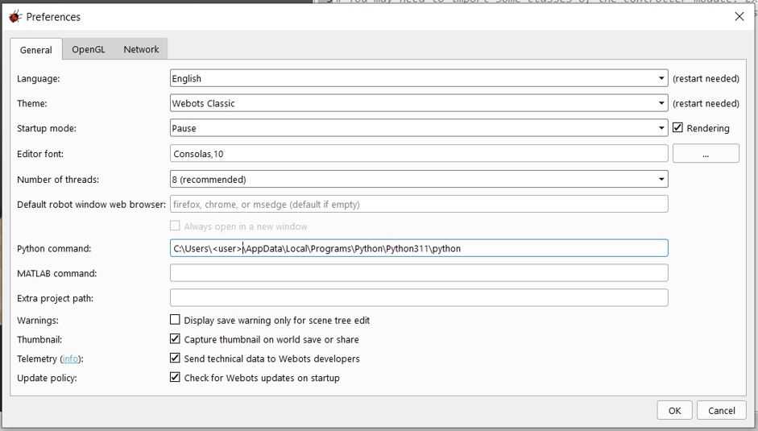

# Veelgestelde vragen

## Als de simulatie niet werkt
Controleer of de juiste preferences zijn ingevuld:
- Ga naar ToolsPreferences
- Vul het veld Python in
  - Python

  - Of als niet werkt volgende

     - `C:\Users\<user>\AppData\Local\Programs\Python\Python311\python.exe`

